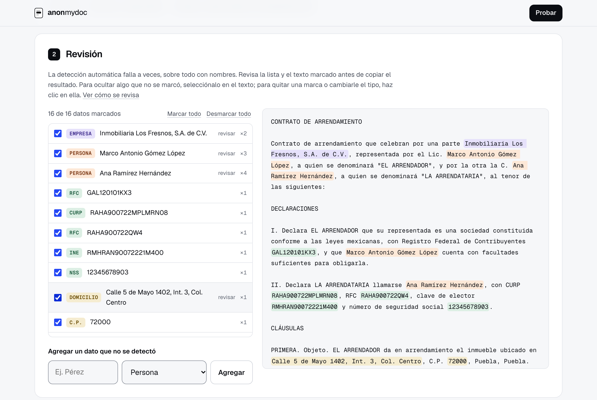

# anonmydoc

Quita los datos personales de un documento antes de pegarlo en una IA y después restaura la respuesta con los datos originales. Pensado para documentos mexicanos. En línea en [anonmydoc.net](https://anonmydoc.net). Lo desarrollé entre septiembre y octubre de 2026; este repositorio se publicó el 1 de noviembre de 2026. El código es privado; aquí se explica cómo funciona y cómo se mide.

## Qué hace

1. Lee el documento en tu navegador: PDF, Word, Excel, PowerPoint, OpenDocument, CSV, correos, texto y archivos de configuración.
2. Marca los datos personales: personas, empresas, RFC, CURP, clave de elector, NSS, CLABE, tarjetas, teléfonos, correos, domicilios, códigos postales, expedientes, placas, IP y contraseñas. Tú revisas la lista antes de seguir.
3. Cambia cada dato por una etiqueta como `[PERSONA_1]` y guarda la correspondencia en un mapa (`.json`) que solo tú tienes.
4. Pegas en la IA el texto con etiquetas. Con su respuesta y el mapa, la página devuelve cada dato a su lugar.
5. Aparte, limpia los metadatos de archivos y fotos y comprueba que la copia quedó limpia.

## Cómo está hecho

- **Todo en el navegador.** La política de seguridad del sitio declara `connect-src 'none'`: el código no puede abrir conexiones aunque quisiera. No hay servidor ni modelo de lenguaje, y funciona con el internet apagado. Cualquiera puede ver la cabecera con `curl -I https://anonmydoc.net`.
- **Reglas, no IA.** La detección son funciones puras: reciben texto y devuelven hallazgos sin tocar la página. Por eso las mismas funciones corren en las pruebas de Node, en la página y en un Worker.
- **Datos separados de las reglas.** Nombres, apellidos, rótulos de formulario y contextos viven en catálogos; ampliar el vocabulario no exige tocar la lógica.
- **Un tubo con contrato por pieza:** `analizar` (todos los candidatos, aunque se traslapen) → `resolver` (lista sin traslapes) → `anonimizar` (texto con etiquetas y mapa) → `validar` (segunda revisión del texto ya anonimizado) → `restaurar` (respuesta de la IA más el mapa).
- **Sin memoria entre visitas.** El mapa vive en la pestaña y en el archivo que descargas; la página no guarda nada en el navegador.

## Cómo se mide

Cada corpus de prueba son documentos con respuesta conocida, escritos por agentes que no tenían acceso al código del detector. Se mide una sola vez antes de revisarlo; esa es la cifra que vale. Después se revisan sus fugas, se corrigen reglas generales y el corpus pasa a ser de desarrollo.

- **Fuga:** un dato del que queda visible una parte que lo identifica.
- **Cobertura:** datos sin fuga entre todos los datos esperados.
- **Precisión:** marcas que caen sobre un dato esperado entre todas las marcas.

Última medición ciega (19 de octubre de 2026): 32 documentos y 882 datos que el motor nunca había visto, con 95.5 % de cobertura (40 fugas) y 93.5 % de precisión. Las dos mediciones ciegas anteriores dieron 89.3 % y 87.8 % de cobertura: la dificultad cambia entre corpus, así que una sola cifra puede sobrestimar. Es una medición interna: el motor y los corpus son privados, así que la cifra no se puede reproducir desde aquí.

Además hay 178 pruebas unitarias en Node y pruebas de extremo a extremo en un navegador real, entre ellas una que corre la página sin internet; también viven en el repositorio privado.

## Bibliotecas de terceros

El sitio sirve desde su propio dominio, sin CDN: pdf.js 3.11.174 (Apache 2.0) para leer PDF, mammoth (BSD de 2 cláusulas) para leer DOCX, pdf-lib (MIT) para limpiar PDF y la fuente Geist (SIL OFL 1.1).

## Límites

- Falla más con nombres sueltos, empresas sin giro conocido y texto en minúsculas. Por eso la lista se revisa antes de copiar.
- Reduce los datos que compartes con la IA; no sustituye el criterio de quien maneja el documento.

## Cómo se hizo

Yo decido qué cuenta como dato personal y cómo se mide; el código lo escribe IA bajo esas pruebas.
